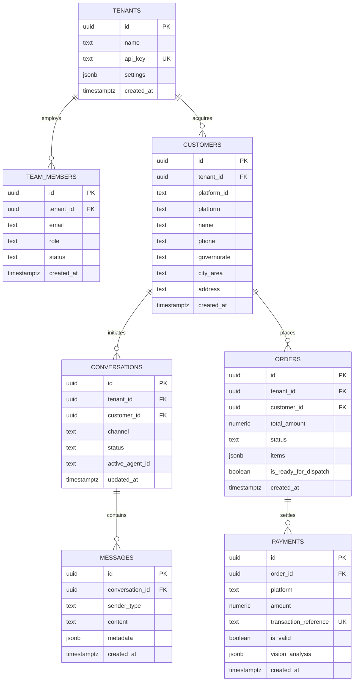

# 🎨 PR Agent — System & UI/UX Design (DESIGN.md)
```
Design Philosophy: Clean, High-Contrast Dark n8n / Linear aesthetic
Component Framework: Shadcn UI + Tailwind CSS + Lucide Icons + Next.js App Router
Persistence: Supabase PostgreSQL + Row Level Security (RLS) + Storage
```

---

## 1. UI/UX System & Design Tokens

### Color Palette (Dark Commerce Theme)
- **Background Root**: `#07040D` (Deep Void Black)
- **Surface Elevation 1**: `rgba(255, 255, 255, 0.02)` / Border: `rgba(255, 255, 255, 0.08)`
- **Surface Elevation 2**: `rgba(255, 255, 255, 0.05)` / Border: `rgba(255, 255, 255, 0.15)`
- **Primary Accent**: `#6366F1` (Indigo 500) to `#9333EA` (Purple 600) Linear Gradient
- **Success / Paid**: `#10B981` (Emerald 500)
- **Pending / In Review**: `#F59E0B` (Amber 500)
- **Alert / Rejection**: `#EF4444` (Rose 500)
- **Typography**: `Tajawal` (Arabic primary font) + `Inter` (Numbers, code & Latin text)

### Layout Topology
1. **Top Nav**: Global status, Workspace switcher, Quick link to Inbox, Settings, and Notifications.
2. **Left/Right Pane (RTL)**:
   - Omnichannel Thread List: Channel badge (Instagram, WhatsApp, Web), Customer avatar, Last message snippet, Active Agent tag.
   - Active Conversation View: Message bubbles, Real-time status badges, Audio player for voice notes, Image viewer for receipts.
   - Quick Action Bar: "Extract Order (AI Parser)", "Verify InstaPay (Vision OCR)", "Escalate to Human".

---

## 2. PostgreSQL Relational Schema (Supabase)



---

## 3. Storage & Media Bucket Organization
- `receipts/`: User-uploaded InstaPay and mobile wallet screenshots (stored with auto-expiry tokens).
- `catalogs/`: Merchant product PDFs, size charts, and high-resolution lookbook images.
- `voice-notes/`: Audio messages received via WhatsApp/Evolution API for Groq Whisper transcription.
