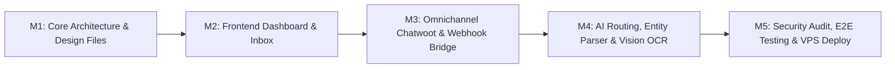

# 🗺️ PR Agent — Master Execution Plan (PLAN.md)
```
Methodology: Software Factory via AI (Plan -> Design -> Agent -> Deploy -> Protect)
Product: PR Agent (Omnichannel AI Social Commerce Moderator & Sales Closer)
Target Market: Egypt & MENA Social Commerce
Infrastructure: GitHub + Next.js 15 (Shadcn UI) + Supabase + Chatwoot Core + Cloudflare + VPS
```

---

## 1. Problem Statement & Market Opportunity
- **The Core Problem**: Egyptian & MENA social commerce merchants (Instagram, Facebook, TikTok, WhatsApp) lose 35-50% of potential orders due to slow response times (>15 mins), messy DMs, manual payment checking (InstaPay/Vodafone Cash fraud), and fragmented spreadsheet tracking.
- **The Solution**: An autonomous AI agent operating as an experienced Egyptian moderator who speaks fluent Egyptian dialect, answers pricing in <3 seconds, converts comments to DMs, parses Egyptian addresses, verifies InstaPay receipts via Vision AI, and syncs directly with human agents in Chatwoot.

---

## 2. Milestone Roadmap (A to Z)



### Milestone 1: Blueprint & Architecture Lock (Day 1)
- [x] Create `blueprint/plan.md` (Features, Milestones, KPIs).
- [x] Create `blueprint/design.md` (UI/UX Design System, Postgres Schemas, State Flow).
- [x] Create `blueprint/agent.md` (Agent Autonomous Protocols, System Prompts, Guardrails).

### Milestone 2: Enterprise Frontend & Merchant Workplace (Day 2)
- [x] Production Landing Page with Dark n8n theme + Schema.org SEO.
- [x] Omnichannel Live Inbox with real-time customer state.
- [x] Kanban Sales Pipeline (`/pipeline`) for order stage management.
- [x] Enterprise Settings (`/settings`) covering Profile, Team, Integrations, API & Webhooks, and Billing.
- [x] PWA offline support and mobile installable app.

### Milestone 3: Open-Source Engine Integration (Day 3)
- [x] Chatwoot Core integration via Docker / Webhooks (`/api/webhooks/chatwoot`).
- [x] Meta Graph API webhook (`/api/webhooks/meta`) for Instagram Comment-to-DM.
- [x] WhatsApp Evolution API ingestion for instant QR code connectivity.

### Milestone 4: Multi-Agent AI Core (Day 4)
- [x] 3-Tier Multi-LLM Router (`src/lib/llmRouter.ts`) with zero overhead:
  - Tier 1: Gemini 1.5 Flash Vision for InstaPay / Vodafone Cash receipts.
  - Tier 2: Groq Llama 3.1 8B Instant for sub-300ms Egyptian dialect closing.
  - Tier 3: Local Deterministic fallback state machine.
- [x] Entity extraction parser for Egyptian addresses and order totals.

### Milestone 5: Security Hardening & Continuous Delivery (Day 5)
- [ ] Automated end-to-end testing with Playwright (`tests/e2e.spec.ts`).
- [ ] Row Level Security (RLS) enforcement on Supabase PostgreSQL.
- [ ] Cloudflare edge caching, DDoS protection, and SSL termination.
- [ ] Hostinger VPS Dockerized deployment with health checks.
